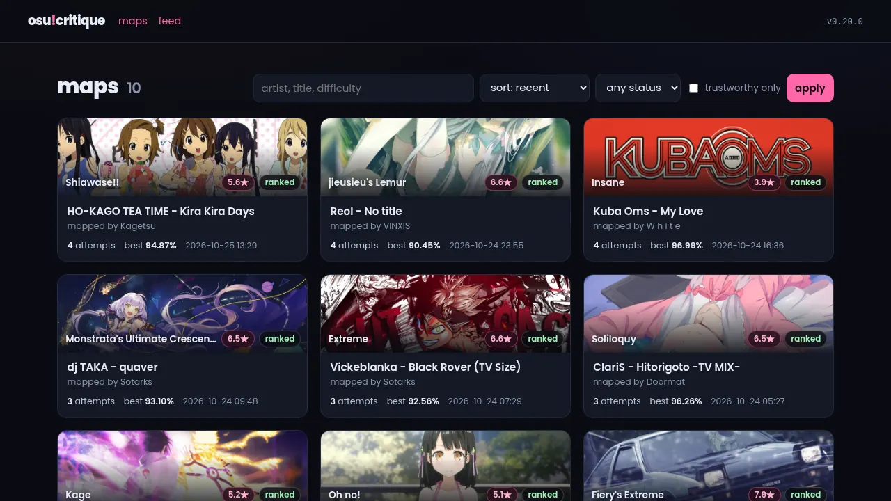
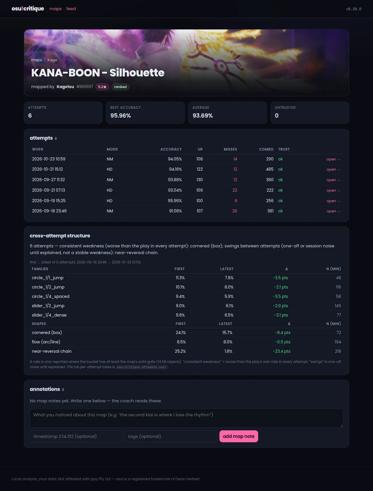
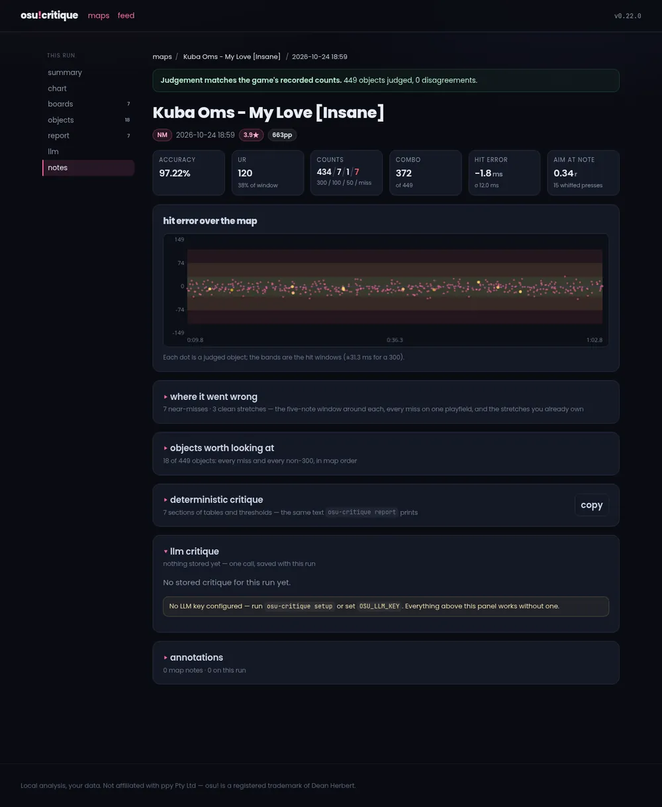
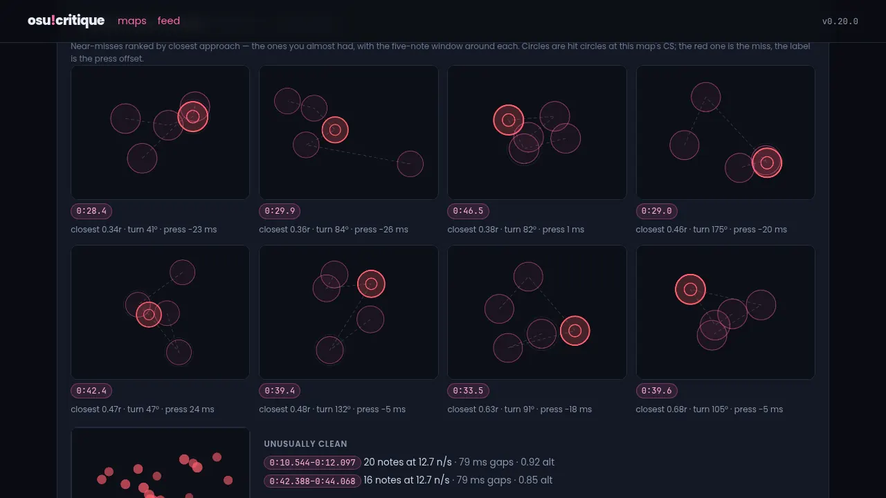
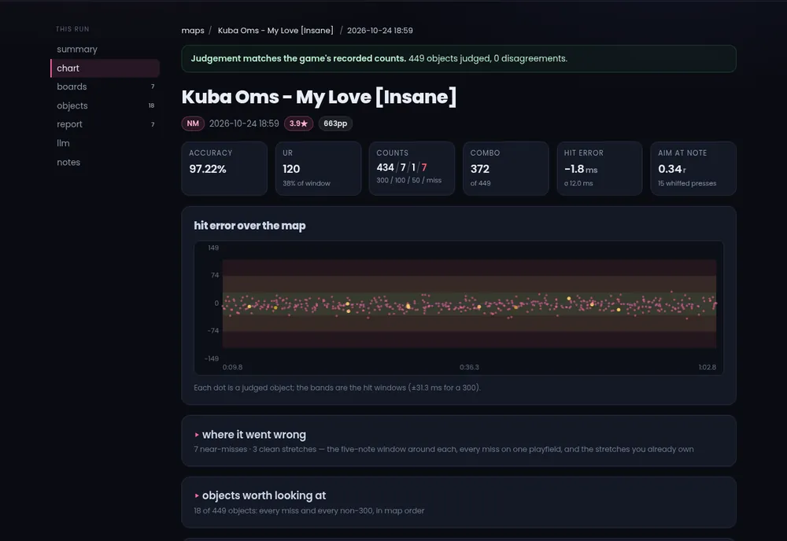
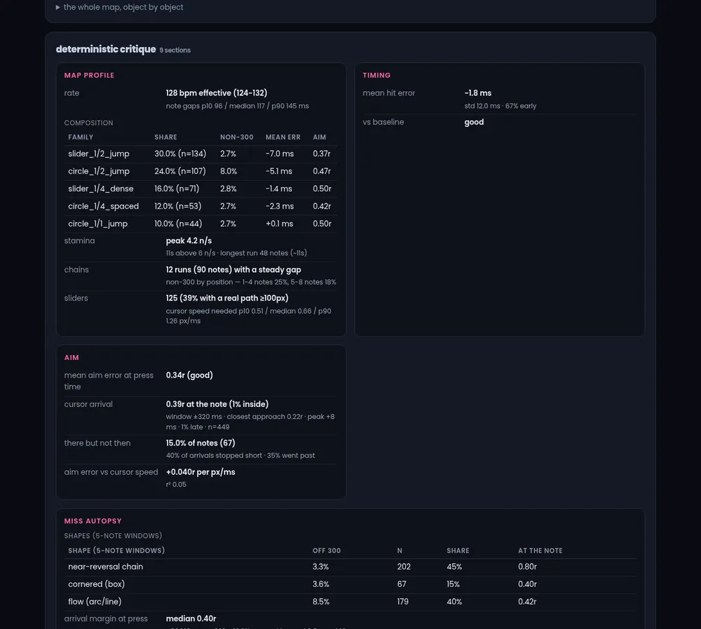
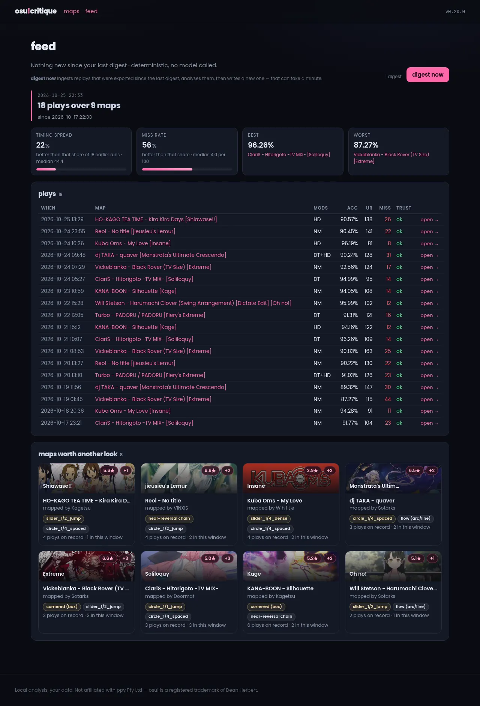

# osu-critique

Data-driven osu! replay analysis and coaching. Parses a replay (`.osr`) and its
beatmap (`.osu`) and produces **validated** per-object metrics — hit error
(timing), aim error (spatial), pattern classification, stream segments, tapping
style, UR — plus charts, a deterministic report, and an optional AI critique.

The analysis core is **fully local: no API keys, no network, no account.** All
optional extras (AI coach, osu! profile) are bring-your-own-key.

> **Status: 0.27.0** — 378 tests (289 run anywhere without optional extras), CI on
> Python 3.10-3.14. The judgement is validated against the game's own recorded
> counts; see [Validation and trust](#validation-and-trust).

## Table of Contents

- [Quickstart](#quickstart)
- [Screenshots](#screenshots)
- [Features](#features)
- [Commands](#commands)
- [Configuration](#configuration)
- [How it works](#how-it-works)
- [Validation and trust](#validation-and-trust)
- [Limitations](#limitations)
- [Development](#development)
- [Roadmap](#roadmap)
- [Privacy, attribution, and terms](#privacy-attribution-and-terms)
- [License](#license)

## Quickstart

Requires Python ≥ 3.10.

```sh
git clone <repo-url> && cd osu-critique
python3 -m venv .venv && source .venv/bin/activate
pip install -e ".[charts]"          # core + matplotlib for --charts
pip install -e ".[web]"             # optional: the local web frontend
```

Replays and maps are found automatically from **osu!lazer** (Windows, Linux
Flatpak/AppImage, macOS), **osu!stable** (Windows), or the repo's `replays/` +
`maps/` folders (`.osr` / `.osu` / `.osz`; archives are unpacked). Then:

```sh
osu-critique batch --charts         # pair + analyze every replay
osu-critique index                  # build the SQLite view over out/
osu-critique report out/            # deterministic critique — no keys, no network
osu-critique serve                  # local web frontend on :8765 ([web] extra)
osu-critique annotate add --map <md5> --t 2:14.312 "the kiai is the wall"
```

That is the core loop. Optional extras, all bring-your-own-key:

- `osu-critique setup` — ~30-second wizard for keys and non-standard paths.
- `osu-critique coach out/` — AI critique via one LLM API call.
- `osu-critique profile <username>` — osu! profile stats for context.

No git? Install the wheel from the latest release:

```sh
pip install https://github.com/ranelb/osu-critique/releases/download/v0.10.1/osu_critique-0.10.1-py3-none-any.whl
```

See [Commands](#commands) for every command, or run `osu-critique --help`.

## Screenshots



<details>
<summary>More screenshots</summary>













</details>

## Features

| Tier | Command | Needs keys? | What you get |
|---|---|---|---|
| **Core** | `analyze`, `pair`, `batch` | no | per-object metrics JSON + charts |
| **Breakdown** | `breakdown` | no | speed cliff, cascades, worst ramp |
| **Report** | `report` | no | deterministic, rule-based critique |
| **Coach** | `coach` | LLM key (BYO) | full natural-language critique of one run |
| **Ask** | `ask` | optional (LLM key for the answer) | ask a question of a *selection*: replays, whole maps, a date range, or any mix |
| **Stars/pp** | `stars`, `pp` | optional extra (`[stars]`) | star ratings and pp per play |
| **Profile** | `profile` | osu! API creds (BYO, optional) | player stats for context |
| **Status** | `status` | osu! API creds (BYO, optional) | pp-eligible vs unranked split |
| **Web** | `serve` | optional extra (`[web]`) | local frontend: map showcase, run pages with near-miss boards, a critique tab that composes selections, the feed |
| **Annotate** | `annotate` | no | notes the coach reads, in map time |
| **Export** | `export` | optional binary + opt-in | replay export from the osu! database |
| **Digest** | `digest` | no | what's new since your last visit; no LLM |

One run becomes a critique three ways: `report` (rule-based, offline), `coach`
(one LLM API call, streamed live), or `prompt` (the framework plus your data, to
paste into any AI). A *selection* of runs — a map's whole history, a week, a mix
of both — goes through `ask` (or the ask page): a deterministic summary first,
optionally with a question on top, and that text is the model's entire input. `coach` and `prompt` take the same
optional `--baseline` (an earlier run, for improvement/regression) and
`--profile <username>` (player context). Both feed the model every analytic
block (including `breakdown`) — the bulky, redundant parts are trimmed, never
the analysis — and automatically join the `stars` / `pp` / `status` caches onto
each run when those commands have been run in the output folder.

Per-play metrics — timing, aim (press and cursor arrival), miss autopsy, slider
bodies, two clocks, rolling baselines, cross-attempt structure, patterns,
streams, tapping, sections, whiffs, map profile, trust — are catalogued in
[docs/metrics.md](docs/metrics.md). The SQLite projection the web frontend
reads is [docs/index.md](docs/index.md); the frontend itself (pages, bind rules,
testing) is [docs/web.md](docs/web.md), and annotations in [docs/annotations.md](docs/annotations.md), and stored critiques in
[docs/ask.md](docs/ask.md). Export and the digest are
[docs/export.md](docs/export.md).

The AI coach is tested with **one model: DeepSeek V4 Flash**
(`deepseek-v4-flash`, `https://api.deepseek.com`) — the default. Other
OpenAI-compatible models and endpoints may work, but are untested.

## Commands

```sh
# analyze a single replay against its map
osu-critique analyze <replay.osr> <map.osu> [tag] [--charts]
# resolve replay->map pairs without analyzing (auto-detects all sources)
osu-critique pair
# pair + analyze every available replay + aggregate table
osu-critique batch --charts
# build / refresh the derived SQLite index of out/ (safe to delete; --check for drift)
osu-critique index [--rebuild|--check]
# local web frontend: map listing, per-map attempts, per-run detail ([web] extra)
osu-critique serve [--host 0.0.0.0] [--port 8765] [--no-index]

# human annotations the coach reads (scope map or run; timestamps in map time)
osu-critique annotate add --map <md5> [--run <replay_md5>] [--t 2:14.312] "note"
osu-critique annotate list [--map <md5>] [--json]
osu-critique annotate rm <note_id>

# opt-in: pull replays from the osu! database, then summarise what's new
osu-critique export [--install|--run] [--status ranked,loved]
osu-critique digest [--since TIME] [--no-ingest]
# show every resolved path (auto-detection diagnostics)
osu-critique paths

# deterministic critique from a metrics JSON (no LLM, no keys)
# a directory prints the cross-run aggregate; --history compares to your stored runs
osu-critique report out/<tag>_metrics.json [--baseline out/<other>_metrics.json]

# cross-attempt structure: stable weakness vs one-off noise (same map, several plays)
osu-critique attempts out/            # or a single metrics JSON; --json, --min-n, --all

# how a play breaks down: speed cliff, reversal buckets, miss cascades, worst ramp
osu-critique breakdown out/<tag>_metrics.json [--json]

# star rating / pp via rosu-pp (optional extra: pip install 'osu-critique[stars]')
osu-critique stars out/               # -> out/stars_by_md5.json
osu-critique pp out/                  # -> out/pp_by_replay.json

# ranked / leaderboard-only / unranked split (osu! API v2)
osu-critique status out/

# AI critique — one LLM API call
osu-critique coach out/<tag>_metrics.json \
    [--baseline out/<other>_metrics.json] [--profile <username>] \
    [--model <any-model-name>] [--prompt <custom-prompt-file>] [--save]

# one critique of a selection: replays, whole maps, a range — or all three
osu-critique ask --since 7d                      # the summary text
osu-critique ask --maps <md5> --until 2026-10-20 \
    -q "did I get better at 1/2 jumps?"
osu-critique ask --maps <md5> --llm              # also call, store, print

# bring your own AI: the framework prompt, or framework + your metrics
osu-critique prompt
osu-critique prompt out/<tag>_metrics.json [--baseline ...] [--profile <username>]

# osu! profile stats (API v2 with credentials, else HTML fallback with --scrape)
osu-critique profile <username> [--scrape]
```

Every command is self-documenting — run `osu-critique <command> --help`.

## Configuration

Settings resolve as **environment variable > config file > auto-detection >
default**. `osu-critique setup` (optional, ~30 seconds) collects your keys and
non-standard paths, and `osu-critique paths` prints everything the tool
resolved. Full setup wizard, platform-probe table and every `OSU_*` variable:
[docs/configuration.md](docs/configuration.md).

## How it works

Each run parses the replay and map, resolves presses against objects in the
game's order with **mod-adjusted** hit windows, calibrates the replay's time
base, then measures: hit/aim error, cursor arrival, miss autopsy, slider bodies,
patterns, streams, tapping, sections, whiffs, the map profile and a `trust`
block. Full pipeline: [docs/internals.md](docs/internals.md).

## Validation and trust

`counts_detected` is judged against the game's own recorded counts: across a
55-replay reference corpus the judgement reproduces **14 plays exactly** and
drifts by a handful of objects on the rest. A 1 ms **edge guard** on the hit
windows — the frame clock is floored to the millisecond — is what makes the
slider-heavy plays agree. Where it cannot be sure, the `trust` block says so
rather than smoothing it over. Full detail: [docs/trust.md](docs/trust.md).

## Limitations

- **Relax replays** — the game taps, so press-time aim, whiffs and tapping are
  the game's; read the cursor-arrival block (`aim_mode`) instead.
- **Sliders are judged by their head** — the body, ticks and tail are measured
  (`metrics.sliders`) but never change the judgement.
- **Mod/time quirks** — some lazer exports store frames in map-time while the mod
  flag claims otherwise; calibration picks the consistent reading and both clocks
  are reported (`metrics.time_base`).

Full list: [docs/trust.md](docs/trust.md).

## Development

```sh
pip install -e ".[dev]"
pytest -q                     # 345 tests (6 need real replays, 76 need [web])
```

- `tests/fixtures/` — committed golden replays + maps, plus synthetic
  edge-case fixtures (see `tests/fixtures/ATTRIBUTION.md`).
- `src/osu_critique/metrics/aim.py` — the cursor-arrival ("aim mode") block and
  its six-panel figure (`docs/aim.md`).
- `src/osu_critique/metrics/autopsy.py` — the miss-autopsy block: shape classes,
  arrival margin, press-vs-arrival, legs, stutter and the misses themselves
  (`docs/autopsy.md`).
- `scripts/autopsy.py` — a thin printer over both blocks for one replay (plus the
  worst-arrival table). It used to be the reference implementation; the numbers
  now come from the library, so they cannot drift.
- `scripts/judge_drift.py` — how far the judgement sits from the game's own
  counts, per replay and in total, with `--guard-sweep` to see what alternative
  window guards would do. This is the measurement every judgement change must be
  re-run against (it is a development tool: it needs real replays).
- `scripts/make_synthetic_fixtures.py` — regenerates the synthetic fixtures
  (including the Relax `synth_rx` pair) and can anonymize `.osr` player names
  (`--anonymize`).
- CI (`.github/workflows/test.yml`) runs the suite on Python 3.10, 3.12, and 3.14.


## Privacy, attribution, and terms

- Developed with heavy use of AI coding assistance.
- Real replay fixtures are locally captured plays, **anonymized**
  (`TestPlayer`); beatmap extracts are credited to their mappers in
  `tests/fixtures/ATTRIBUTION.md`.
- The `profile` HTML-scrape fallback is **unofficial and opt-in only**
  (`--scrape` flag or `allow_scrape` config option); the default path is the
  official API v2, and the osu! Terms of Service should be respected.

## License

MIT. Third-party libraries: `slider` (MIT), `numpy`, `matplotlib`.
Not affiliated with osu! / ppy Pty Ltd; osu! is a registered trademark of
Dean Herbert.
